# App Tour

A page-by-page look at the Attendance Tracker. Every screenshot comes from the built-in demo data (10 fictional employees, the generic Default brand), so what you see here is what you'll get from `npm run dev:demo`.

**Contents:** [Signing in](#signing-in) · [Dashboard](#dashboard) · [Attendance](#attendance) · [Reports](#reports) · [Employees](#employees) · [Users](#users) · [Settings](#settings) · [The employee's view](#the-employees-view) · [Try it yourself](#try-it-yourself)

---

## Signing in

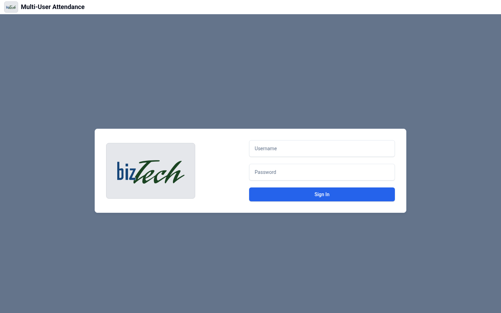

Everyone signs in with a username and password. The logo and app name come from the active brand, so each organization sees its own branding. What a person can see and do after signing in depends on their **group** (whose data they can see) and **role** (what they can change). See [Authentication & Security](../README.md#authentication--security) in the README.

---

## Dashboard

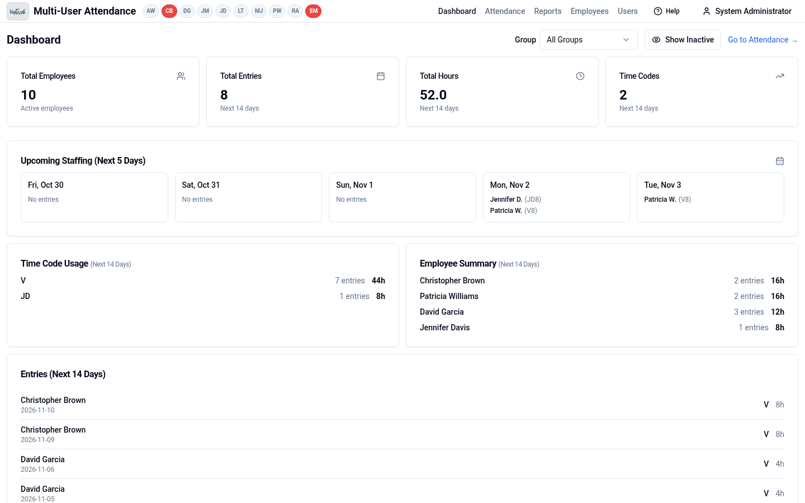

The dashboard answers "who's out soon?" at a glance:

- **Summary cards**: active employees, plus the number of entries, hours, and distinct time codes scheduled over the next 14 days.
- **Upcoming Staffing**: the next five days, with each person who's out and their code and hours (for example `V8` is 8 hours of vacation).
- **Time Code Usage** and **Employee Summary**: totals for the next 14 days by code and by person.
- **Entries**: the individual upcoming entries, soonest last.

The **Group** filter narrows everything to one team, and **Show Inactive** includes former employees.

The row of initials in the header is the **office presence bar**. Each person toggles their own chip to mark themselves in or out of the office today, and red chips mean "out".

---

## Attendance

This is the screen that replaces the Excel attendance sheet. Pick a group and an employee (or **All Employees**), then switch between Year, Month, and Week views.

### Year view

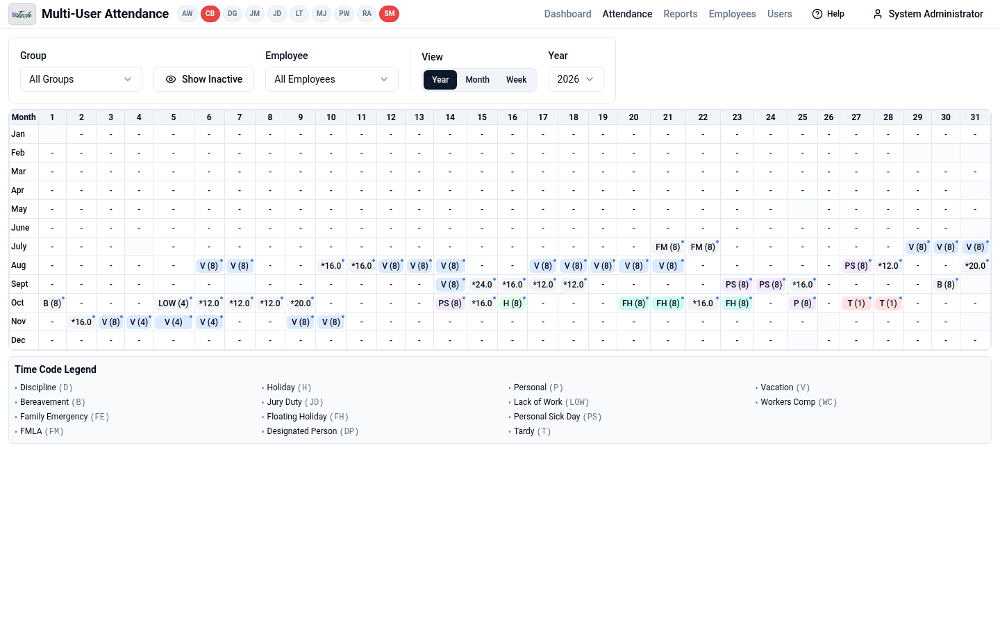

The familiar spreadsheet layout: 12 months by 31 days. Each cell shows the time code and hours, such as `V (8)` for an 8-hour vacation day, color-coded by type. With **All Employees** selected, days where several people have entries show the combined hours with an asterisk (`*16.0`). A small dot means the entry has notes. Days that don't exist, such as Feb 30, are greyed out. The legend lists every time code.

### Month view

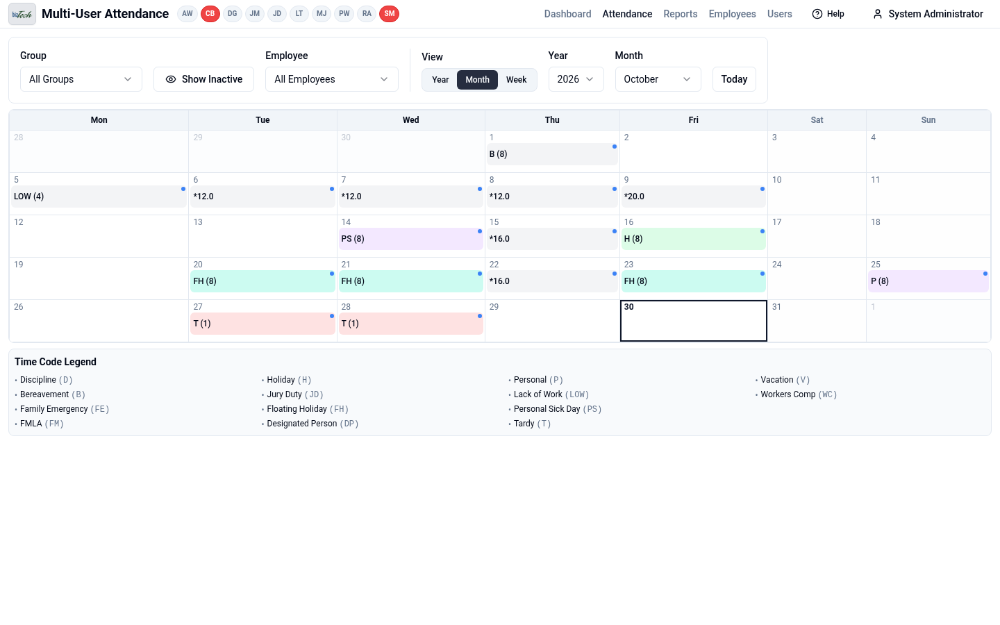

A traditional calendar grid, Monday through Sunday, with today outlined. Use the Month dropdown or **Today** to move around.

### Week view

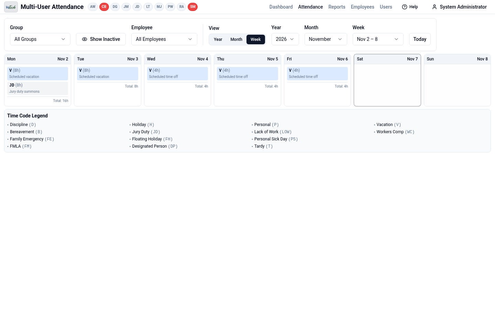

One card per day with the full detail of each entry: code, hours, and notes, plus a daily total. This is also the layout phones switch to automatically.

### Editing an entry

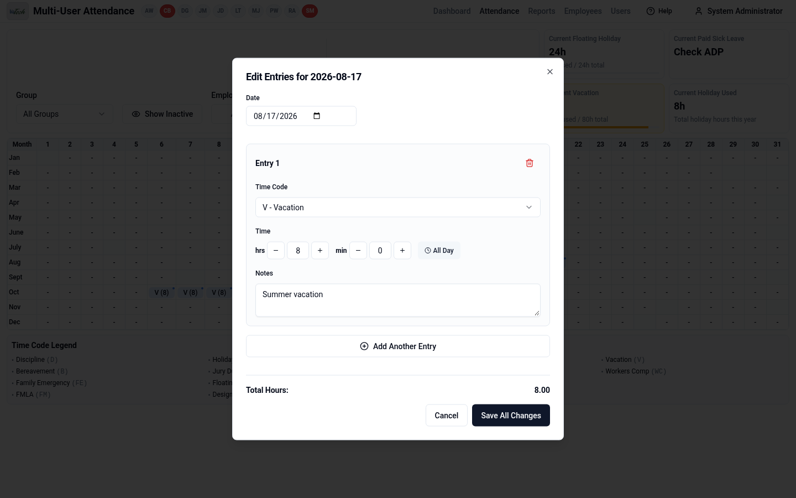

Click any day to open the entry dialog. Choose a time code, set hours and minutes (or **All Day**), and add notes. **Add Another Entry** handles split days, such as a half day of vacation plus a half day of sick time. Changes are saved together with **Save All Changes**.

When a single employee is selected, as here, **balance cards** appear above the grid showing how much of each limited leave type they've used against their allowance for the year.

### Dark mode

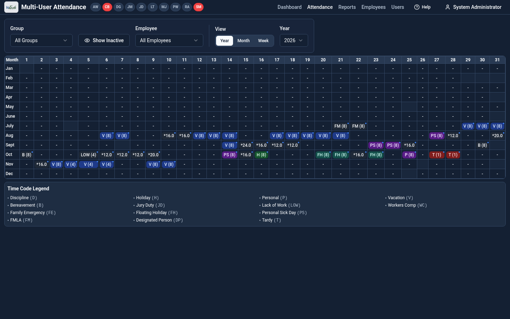

Every screen supports light and dark modes. By default the app follows the device's setting, and each user can override it in Settings.

---

## Reports

Choose a report from the **Report** dropdown at the top right. Every report can be printed or saved as PDF and exported to CSV.

### Attendance Summary

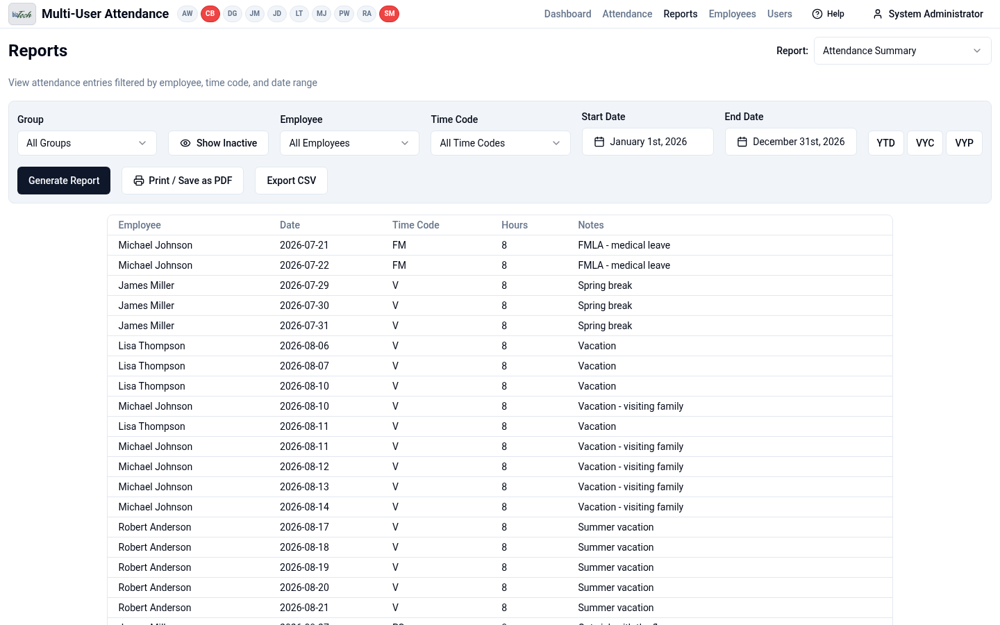

A filterable list of every entry. Filter by group, employee, time code, and date range. The **YTD**, **VYC** and **VYP** buttons are shortcuts for year-to-date and the current and previous vacation years.

### Leave Balance Summary

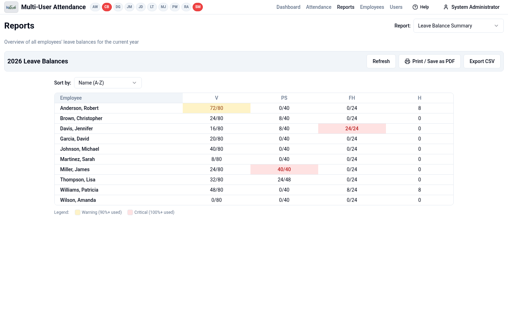

Everyone's leave balances for the year on one page, shown as hours used against the allowance. Cells turn **amber** at 90% used and **red** at 100%, so people about to run out stand out immediately. It can be sorted by name or by usage.

### Attendance Management Report

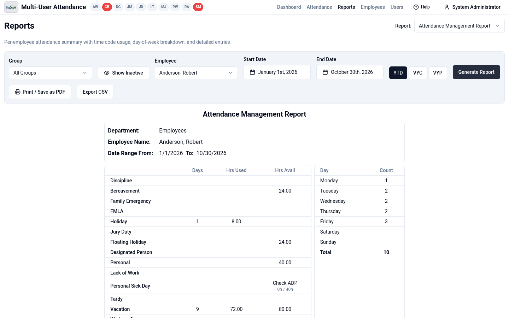

A one-employee summary sheet for reviews or HR files:
- hours used and still available for each time code
- a day-of-week breakdown, useful for spotting patterns such as frequent Monday absences
- the detailed entries for the chosen date range

---

## Employees

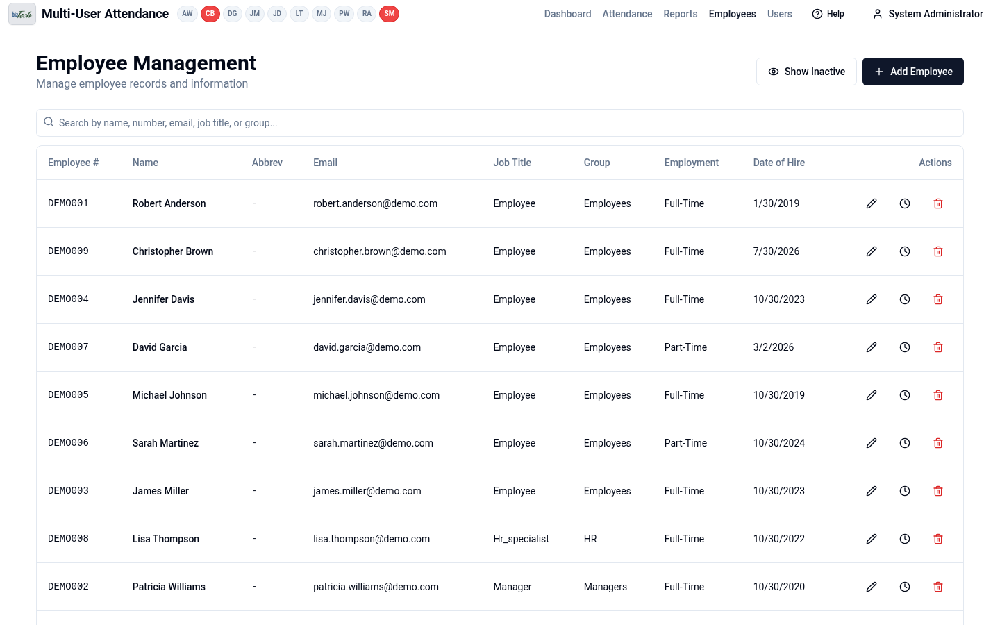

The employee list is searchable by name, number, email, job title or group. From each row you can:
- **edit** the employee's record (pencil)
- adjust their individual **leave allowances** (clock), for example extra sick time approved by HR or reduced hours for part-time staff
- **deactivate** them (trash)

Deactivated employees keep their history and can be reactivated with **Show Inactive**.

---

## Users

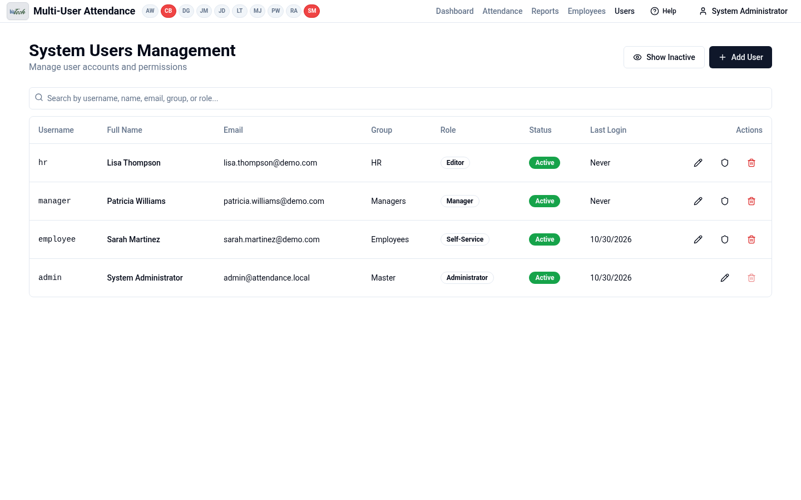

Login accounts are separate from employee records, so you can have managers or HR staff who log in but aren't tracked. Each user has a group, a role, and an active or inactive status. The shield icon opens per-group permissions. The built-in administrator account can't be deleted.

---

## Settings

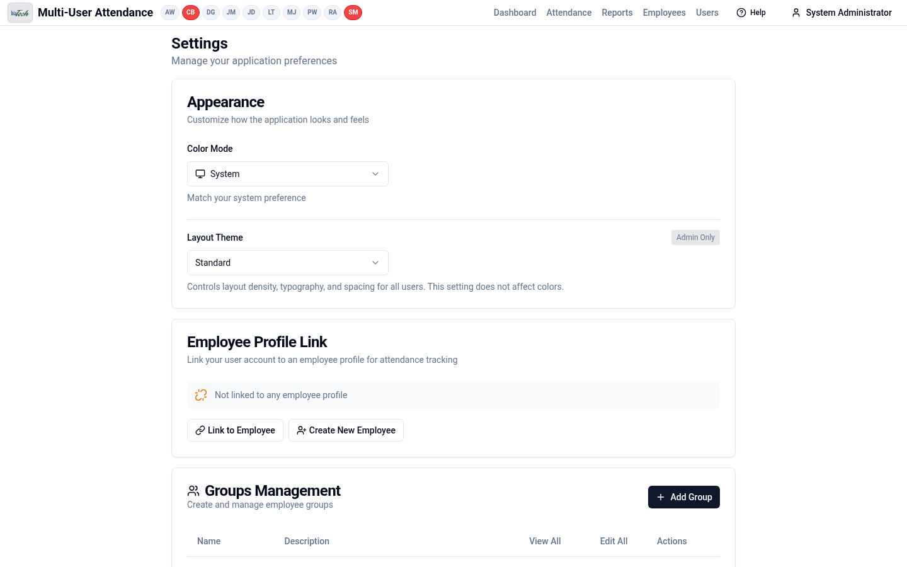

- **Appearance**: light, dark, or follow the system, plus an admin-only layout theme that applies to everyone.
- **Employee Profile Link**: connects your login to your employee record, so the attendance screen opens on your own data.
- **Groups Management**: create groups and control who can view or edit each one.

Admins see further sections below these, such as office capacity thresholds, time code colors and backups, depending on which features the brand enables.

---

## The employee's view

The same app looks much simpler for a regular employee with the Self-Service role.

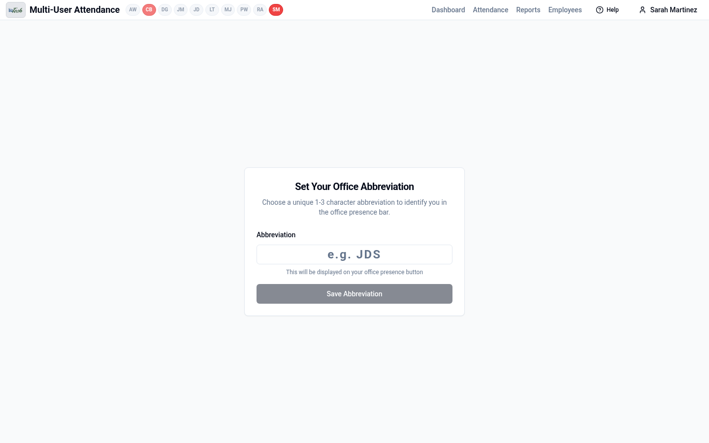

On first sign-in, employees pick a short abbreviation (1 to 3 characters) for their chip on the office presence bar.

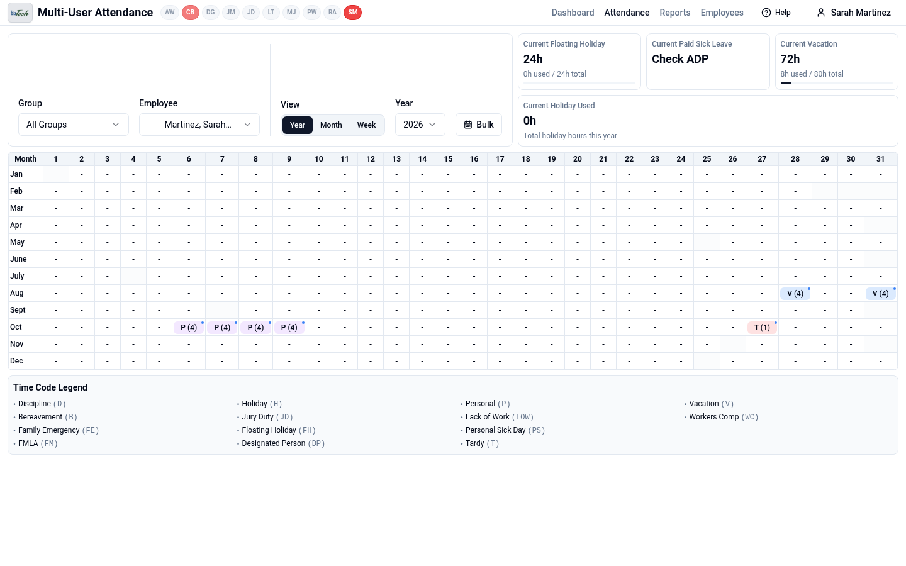

After that, they land on their own attendance record with their balances at the top: floating holiday, sick leave, vacation, and holidays used. They can see their history, and their role decides whether they can make changes. Admin pages such as Users and the admin settings sections don't appear for them.

---

## Try it yourself

Run the demo locally. The database is wiped and reseeded every time the server starts:

```bash
npm install
npm run dev:demo
```

Then open http://localhost:6029 and sign in with one of the demo accounts:

| Username | Password | Role |
|----------|----------|------|
| `admin` | `admin123` | Administrator: sees everything |
| `manager` | `demo123` | Manager (Patricia Williams) |
| `hr` | `demo123` | HR (Lisa Thompson) |
| `employee` | `demo123` | Self-Service (Sarah Martinez) |

### Updating these screenshots

The screenshots are generated by [`scripts/capture-screenshots.mjs`](../scripts/capture-screenshots.mjs). With the Default brand selected (`npm run select-brand`), start a fresh demo server (`npm run dev:demo`). Then, in a second terminal:

```bash
npm run docs:screenshots
```

The script needs Chromium installed (`/usr/bin/chromium`, or set `CHROMIUM_PATH`). Restart the demo server before each run, because the script completes the employee's first-login step and that only appears on fresh data.
